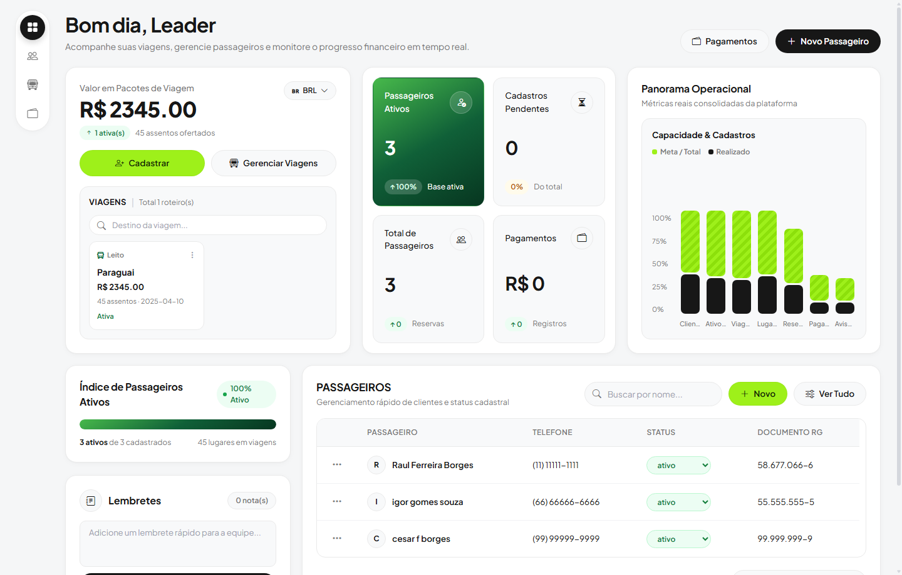
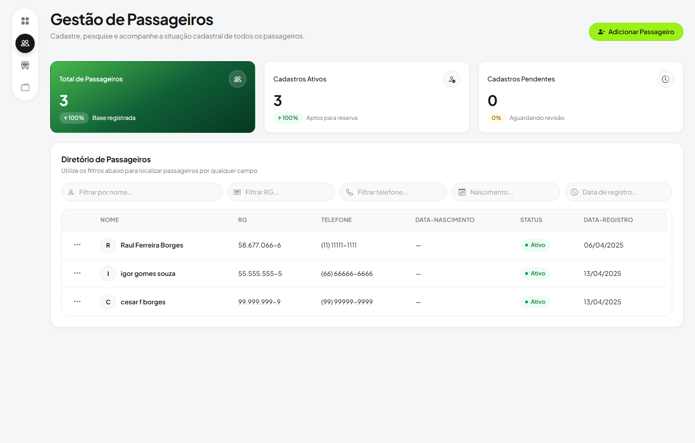
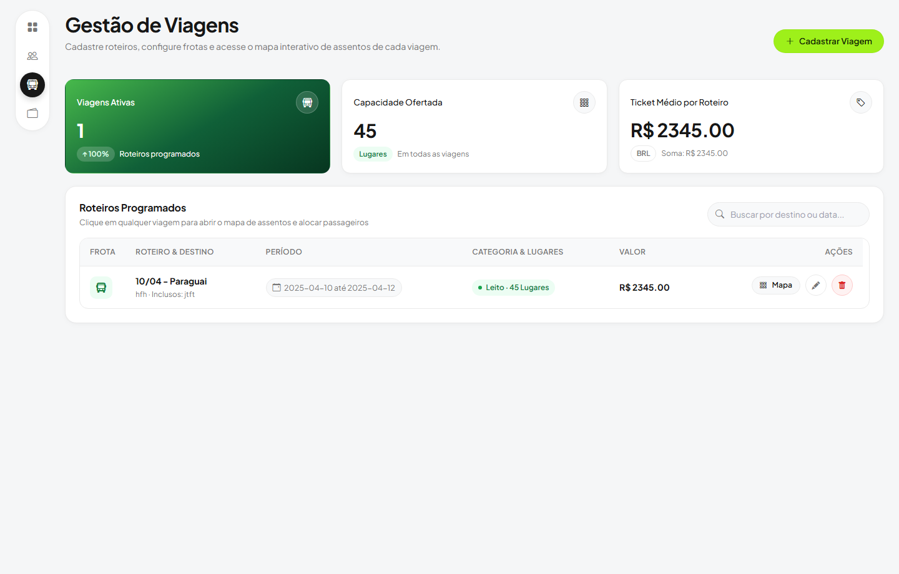
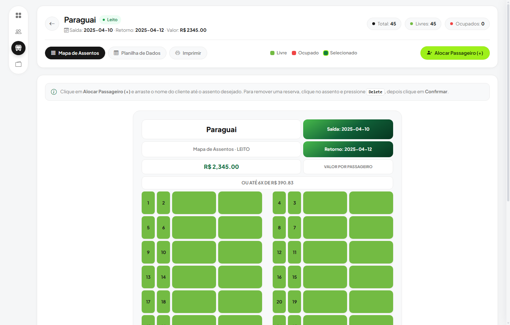
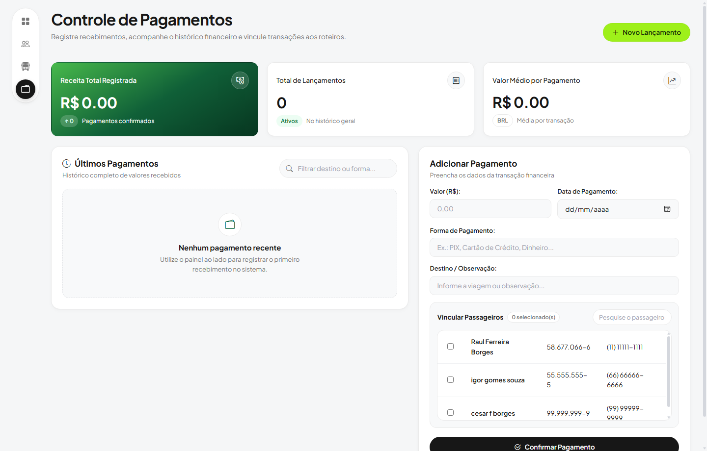

# Leader Viagens — Sistema de Gestão Financeira e Operacional de Turismo

Aplicação web full-stack desenvolvida em Python com Flask e SQLAlchemy para o gerenciamento integrado de agências de viagens e fretamento turístico. O sistema centraliza o controle de roteiros, cadastro e validação documental de passageiros, alocação visual de poltronas em mapa interativo de ônibus e acompanhamento financeiro de recebimentos.

---

## Sumário

1. [Visão Geral do Projeto](#visão-geral-do-projeto)
2. [Demonstração do Sistema](#demonstração-do-sistema)
3. [Funcionalidades Principais](#funcionalidades-principais)
4. [Arquitetura e Padrões de Projeto](#arquitetura-e-padrões-de-projeto)
5. [Tecnologias Utilizadas](#tecnologias-utilizadas)
6. [Estrutura de Diretórios](#estrutura-de-diretórios)
7. [Como Baixar e Executar o Sistema](#como-baixar-e-executar-o-sistema)

---

## Visão Geral do Projeto

O **Leader Viagens** foi projetado para substituir controles manuais e planilhas descentralizadas na operação de excursões e viagens rodoviárias. A interface segue uma arquitetura de navegação enxuta baseada em barra lateral de ícones e painéis analíticos (KPIs), permitindo que operadores consultem rapidamente a ocupação das frotas, a situação cadastral dos clientes e o fluxo de caixa por roteiro.

---

## Demonstração do Sistema

### 1. Painel Executivo (Visão Geral)

Tela inicial que consolida os principais indicadores operacionais em tempo real: valor total ofertado em pacotes, quantidade de viagens ativas, proporção de passageiros ativos versus pendentes, gráfico de capacidade operacional, quadro de lembretes da equipe e atalhos rápidos para os roteiros e cadastros recentes.



### 2. Gestão e Diretório de Passageiros

Módulo dedicado ao ciclo de vida cadastral dos clientes. Conta com indicadores de base ativa/pendente, formulário retrátil para inclusão e edição de dados pessoais (Nome, RG, CPF, Data de Nascimento, Telefone e Status) e tabela com filtragem simultânea em tempo real por múltiplos campos.



### 3. Gestão de Viagens e Roteiros

Ambiente para criação e administração das viagens programadas. Registra destino, datas de saída e retorno, categoria do ônibus (Leito ou Semi-leito), capacidade total de assentos, valor individual, descrição do roteiro e itens inclusos, calculando automaticamente a capacidade total ofertada e o ticket médio.



### 4. Mapa Interativo de Assentos e Planilha de Embarque

Estúdio visual de ocupação do ônibus gerado dinamicamente conforme a numeração de assentos da viagem (incluindo suporte a piso superior e piso inferior). Permite alocar passageiros nas poltronas via recurso de arrastar e soltar (Drag-and-Drop), inspecionar os documentos do passageiro ao passar o cursor sobre o assento ocupado, alternar para a visualização em planilha de embarque e imprimir a lista de passageiros.



### 5. Controle de Pagamentos

Módulo financeiro para lançamento de recebimentos por data, valor, forma de pagamento e destino/referência, permitindo vincular transações diretamente aos passageiros cadastrados e auditar o histórico de entradas.



---

## Funcionalidades Principais

- **Dashboard Analítico em Tempo Real:** Cálculo automático de métricas financeiras, taxa de ativação de clientes e ocupação de assentos.
- **Cadastro e Validação de Passageiros:** Verificação de integridade de nome completo, telefone e unicidade de RG, com alteração rápida de status cadastral (`ativo` ou `pendente`).
- **Gerenciamento Completo de Roteiros (CRUD):** Criação, edição, listagem filtrada e exclusão de viagens com suporte a diferentes configurações de frota.
- **Alocação Interativa de Poltronas:** Mapa gráfico de assentos com suporte a Drag-and-Drop, remoção de reservas e modo de impressão de manifesto de viagem.
- **Registro e Associação de Pagamentos:** Lançamento de receitas com associação N:N entre pagamentos e passageiros.
- **Mural de Lembretes Operacionais:** Criação e exclusão de notas rápidas na tela inicial para comunicação interna.

---

## Arquitetura e Padrões de Projeto

A aplicação foi estruturada em camadas bem definidas para garantir separação de responsabilidades e facilidade de manutenção:

- **Models (`models/`):** Entidades mapeadas via ORM SQLAlchemy (`Viagem`, `Passageiro`, `Reserva`, `Pagamento`, `Financeiro`, `Lembrete` e tabela associativa `passageiro_pagamento`).
- **Data Access Objects (`dao/`):** Camada responsável pelas operações diretas de persistência e consultas no banco de dados via sessão do SQLAlchemy.
- **Repositories (`repository/`):** Camada intermediária que abstrai os DAOs e expõe métodos de negócio coesos para os controladores.
- **Controllers (`controllers/`):** Blueprints do Flask que gerenciam as rotas HTTP, validações de entrada, mensagens de feedback (`flash`) e renderização dos templates.
- **Views (`templates/` e `static/`):** Templates dinâmicos renderizados com Jinja2 e folhas de estilo CSS modulares utilizando variáveis de design system e layout responsivo em CSS Grid e Flexbox.

---

## Tecnologias Utilizadas

| Camada | Tecnologia |
| :--- | :--- |
| Linguagem Principal | Python 3 |
| Framework Web | Flask 3.1 |
| ORM e Persistência | Flask-SQLAlchemy / SQLAlchemy 2.1 |
| Banco de Dados | SQLite (`instance/ex.db`) |
| Motor de Templates | Jinja2 |
| Front-end | HTML5, CSS3 (CSS Grid, Flexbox, Custom Properties), JavaScript (ES6+) |
| Iconografia e Tipografia | Bootstrap Icons 1.11, Plus Jakarta Sans |

---

## Estrutura de Diretórios

```text
leader-viagens/
├── app.py                      # Ponto de entrada da aplicação e registro de Blueprints
├── database.py                 # Inicialização e configuração do SQLAlchemy / SQLite
├── requirements.txt            # Dependências Python do projeto
├── controllers/                # Controladores de rotas (Blueprints Flask)
│   ├── IndexController.py
│   ├── PassageiroController.py
│   ├── ViagemController.py
│   ├── ReservaController.py
│   ├── PagamentoController.py
│   ├── LembretesController.py
│   └── ErrorController.py
├── models/                     # Modelos de dados (ORM SQLAlchemy)
├── dao/                        # Objetos de acesso a dados (queries e transações)
├── repository/                 # Camada de repositório e componente de navegação lateral
├── static/styles/              # Arquivos CSS modulares e ativos visuais
├── templates/                  # Templates HTML/Jinja2 das páginas e tratamento de erros
├── instance/                   # Banco de dados SQLite local (ex.db)
└── docs/screenshots/           # Capturas de tela reais do sistema utilizadas na documentação
```

---

## Como Baixar e Executar o Sistema

Siga as instruções abaixo para clonar o repositório e executar a aplicação em seu ambiente local.

### Pré-requisitos

- **Python 3.10+** instalado no sistema
- **Git** instalado no sistema

### Passo a Passo

1. **Clone o repositório:**

```bash
git clone https://github.com/raul4500/leader-viagens.git
cd leader-viagens
```

2. **Crie e ative um ambiente virtual Python:**

No Windows (PowerShell):
```powershell
python -m venv .venv
.\.venv\Scripts\Activate.ps1
```

No Linux ou macOS:
```bash
python3 -m venv .venv
source .venv/bin/activate
```

3. **Instale as dependências do projeto:**

```bash
pip install -r requirements.txt
```

4. **Inicie o servidor de desenvolvimento:**

```bash
python app.py
```

5. **Acesse no navegador:**

Abra o navegador no endereço:
```text
http://localhost:5000
```

O banco de dados SQLite (`instance/ex.db`) é inicializado automaticamente na primeira execução caso ainda não exista.
